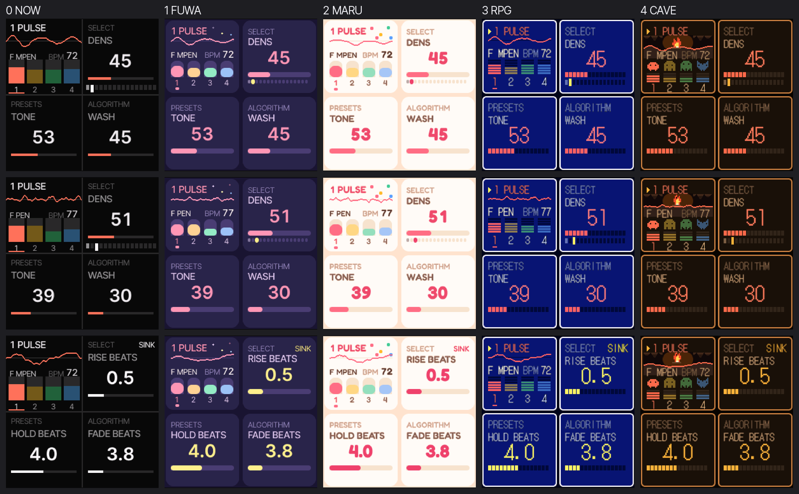
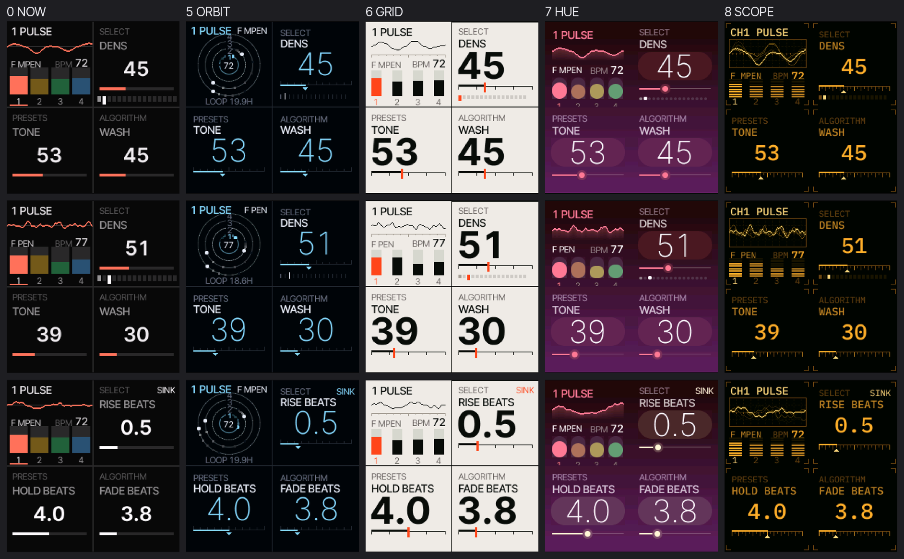
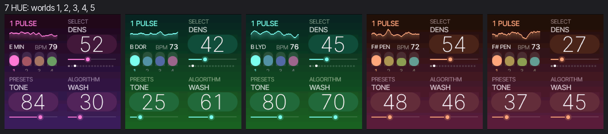
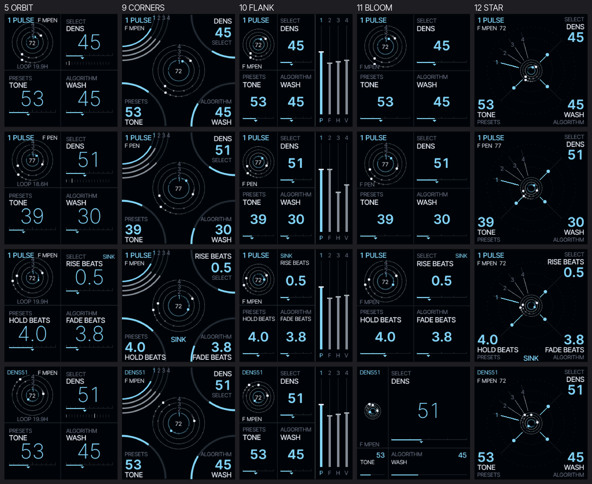
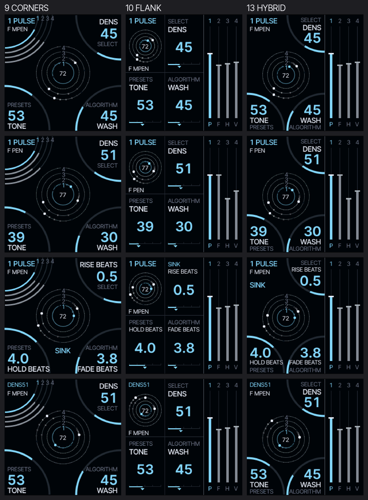

# 画面デザイン案のスクショ（プレビュー）

**このディレクトリの絵は常にこの1か所・同じファイル名で更新する**（案ごと・ブランチごとに増やさない）。見るのは比較シート `mk_styles.png`（第1弾: 色と書体）、`mk_styles2.png`（第2弾: MAKU の定義から）、`mk_layouts.png`（第3弾: 画面の割り方）、`mk_hybrid.png`（CORNERS と FLANK の合いの子）でよい。



列は左から 現状 / 1 FUWA / 2 MARU / 3 RPG / 4 CAVE。行は上から 世界A（seed 7）/ 世界B（seed 99）/ SINK を押している間。

| 案 | 狙い | 書体 |
| --- | --- | --- |
| 0 NOW | 現状（出荷中の画面） | Inter Tight |
| 1 FUWA | 藍の夜にパステル。丸いカード、丸薬のバー、またたく星 | Inter Tight |
| 2 MARU | 桃色の紙に、キャンディ色。丸いカード、紙吹雪 | Fredoka |
| 3 RPG | 深い青の窓に白い枠。区切りゲージ、▶ のカーソル | DotGothic16 |
| 4 CAVE | 松明の色の窓。**地面が波形**で、その上に焚き火。4つのパートは小さな生き物 | DotGothic16 |

個別の絵（seed 7）: [現状](style0_now.png) · [1](style1.png) · [2](style2.png) · [3](style3.png) · [4](style4.png)

## 第2弾: かっこいい方面（MAKU の定義から抽象化）



列は左から 現状 / 5 ORBIT / 6 GRID / 7 HUE / 8 SCOPE。行は第1弾と同じ。

第1弾（FUWA / MARU / RPG / CAVE）は「ジャンルの衣装」だった。第2弾は、MAKU の中身から画面を決めた。

| MAKU の定義 | そこから抜いた原則 |
| --- | --- |
| 4つの役は 16・57・13・29 ステップ（互いに素）。ずらしてあるので何時間も同じ並びに戻らない | 周期のずれそのものを描く → **ORBIT** |
| 保存しない。起動のたびに違う世界 | 世界ごとに見た目が決まる → **HUE**（調 = 色） |
| 幕間の機械。ステージの裏の暗がりで、ちらっと見るもの | 静かで、一目で読める。数字が主役 → **GRID**（数字を絵にする） |
| 手のひらの機材。波形は音そのもの | 計器の顔つき（目盛り、残光、LED）→ **SCOPE** |

| 案 | 内容 | 書体 |
| --- | --- | --- |
| 5 ORBIT | 4つの輪。ステップごとに目盛りがあり、いまのステップに彗星の尾がつく。中心に BPM、下に「いまの4周期が揃うまで」（72 BPM で約19.9時間） | Inter Tight（細い大きな数字） |
| 6 GRID | 紙と細い線と朱色ひとつ。巨大な数字が左に寄る。四角と罫線だけ | Inter Tight（太い大きな数字） |
| 7 HUE | ROOT（調）が画面全体の色相になる。空のような階調、波形は尾根の線、細い数字。KEY を動かすと色がその場で変わる | Inter Tight |
| 8 SCOPE | 琥珀色の蛍光、目盛り、トレースの残光、定規のゲージ、LED の列 | IBM Plex Mono |

HUE は世界ごとに色が変わるので、同じ案を別の世界で並べたのが下の1枚（調は E、B、B、F#、F#）。



## 第3弾: 画面の割り方（ORBIT の見た目で）



列は左から 5 ORBIT（いまの 2×2）/ 9 CORNERS / 10 FLANK / 11 BLOOM / 12 STAR。行は 世界A / 世界B / SINK を押している間 / SELECT を回した直後。

本体のつまみの並びは、画面の左に 2×2（MASTER SELECT / PRESETS ALGORITHM）、右に KNOB 1〜4 の横一列。どの案も「つまみのある方向に、そのつまみの中身」は守っている。波形は出さない。

| 案 | 割り方 | つまみとの対応 |
| --- | --- | --- |
| 9 CORNERS | 区画をやめる。真ん中いっぱいに4つの輪。各マクロは自分の角を中心にした四分円の弧（値の分だけ伸びる） | 弧の位置 = つまみの方向。MASTER の角には4つの音量が扇になる |
| 10 FLANK | 画面を本体の縮図にする。左 2/3 が左のつまみの 2×2、右 1/3 が KNOB 1〜4 の4本のフェーダー | 左右の並びまで本体と同じ |
| 11 BLOOM | 2×2 のまま、十字が動く。回したつまみの区画が大きくなり、しばらくすると戻る | 区画の位置は動かない。大きさだけが変わる |
| 12 STAR | 区切り線なし。真ん中から各つまみの角へ光線（長さ = 値）。音量は MASTER の角へ4本の扇 | 光線の向き = つまみの方向 |

### 13 HYBRID（CORNERS と FLANK の合いの子）



左 2/3 は CORNERS の構図を左のつまみの 2×2 に縮めたもの: 真ん中に4つの輪、SELECT / PRESETS / ALGORITHM はその区画の角の四分円の弧、MASTER の角に いまの役と調。右 1/3 は FLANK と同じく KNOB 1〜4 の4本のフェーダー。本体の左右の並びをそのまま写しつつ、輪を主役にできる。

## 触って見る

エミュレーター（`web/emu/build.sh` で作る）の URL に `#style=N`（0〜13）を付ける。`#seed=7&style=4` のように、世界も指定できる。

## 撮り直す

```
python3 -c "import sys; sys.path.insert(0, 'tools'); import build; build.generate()"   # 初回だけ
sh web/emu/build.sh                  # emcc が要る
node tools/mk_shots.mjs              # docs/shots/mk_styles.png を作り直す（Playwright と Chromium が要る）
node tools/mk_shots.mjs docs/shots/mk_styles2.png 0,5,6,7,8      # 第2弾。引数: 出力、案の列、世界(seed)の列
node tools/mk_shots.mjs docs/shots/hue_keys.png 7 1,2,3,4,5      # 案が1つなら、その世界を並べる
node tools/mk_shots.mjs docs/shots/mk_layouts.png 5,9,10,11,12   # 第3弾
node tools/mk_shots.mjs docs/shots/mk_hybrid.png 9,10,13         # 合いの子
```

## 実装

- `firmware/src/ui_maku_style.c`（1〜4）、`ui_maku_style2.c`（5〜8）、`ui_maku_style3.c`（9〜13、画面全体を 240×120 の帯2本で描く）: 12案の描画。**エミュレーターだけ**（`-DMK_STYLES`）。出荷ファームには入らない。
- 色・書体・配置は案ごとの表（`MKS`）にあり、同じ描画関数が使う。データとレイアウトの決まりは出荷中の画面と同じ（つまみ1つに1区画）。
- 追加の書体は `tools/gen_mk_fonts.py`（Fredoka、DotGothic16、IBM Plex Mono。どれも SIL OFL 1.1）と、Inter Tight の別の太さ。出荷ファームの書体は変えていない。
